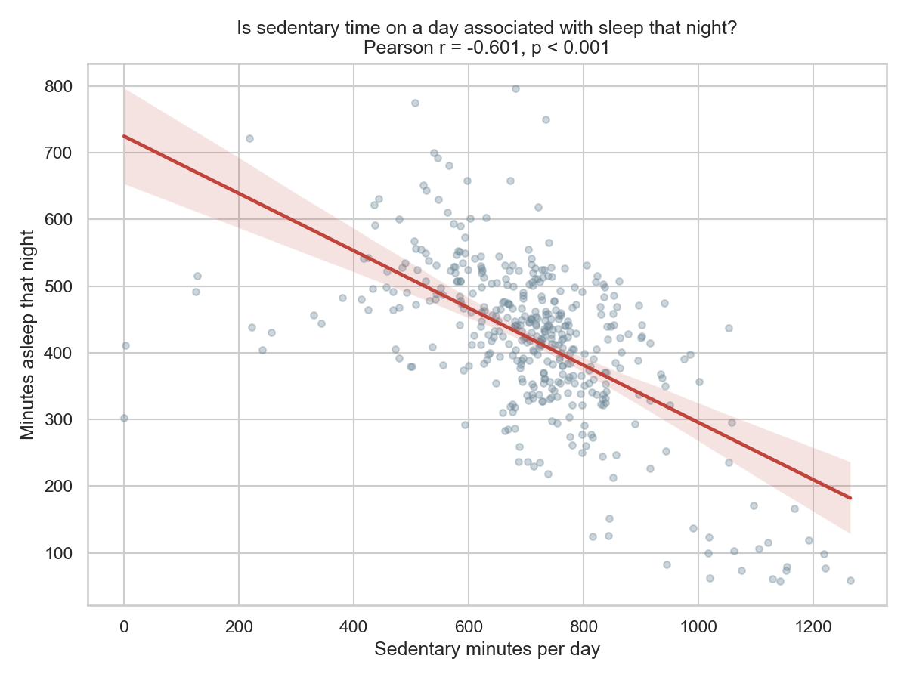
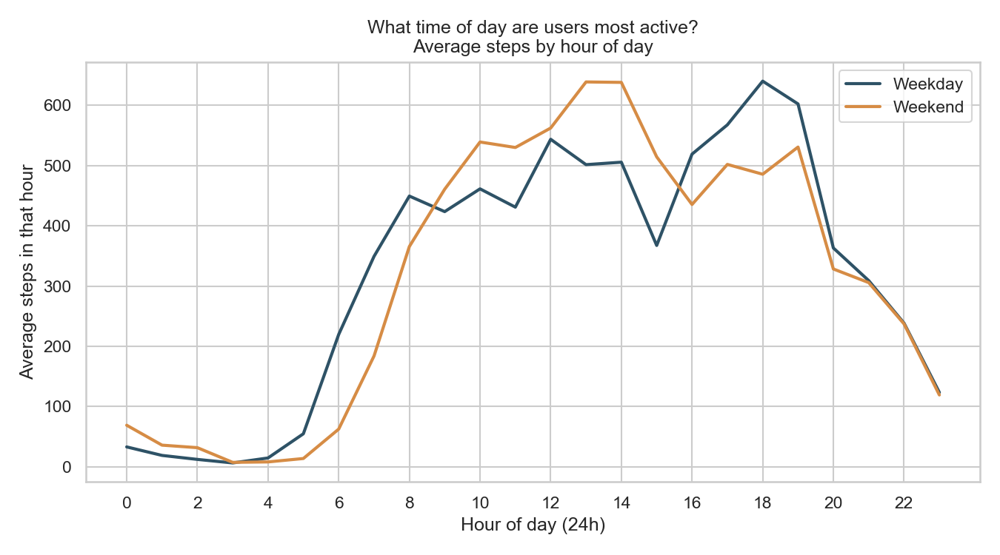

# Bellabeat Smart Device Usage Analysis

A reproducible business-intelligence case study that analyzes how people use fitness trackers, and turns those usage patterns into marketing recommendations for **Bellabeat**, a maker of health-focused smart products for women.

The analysis uses the public **Fitbit Fitness Tracker dataset** (Fitabase export of 33 users over 31 days, April–May 2016). It follows the six-phase **Ask → Prepare → Process → Analyze → Share → Act** framework, and it is built twice, independently:

- **Python** (pandas, SciPy, scikit-learn): the authoritative pipeline. It does the cleaning, the statistical tests, the k-means segmentation, and all charts.
- **SQL** (SQLite): a second implementation of the same logic for SQL/BI users. Its results are cross-checked against the Python output.

> **Want the findings without the code?** Read [`docs/executive_summary.md`](docs/executive_summary.md) (one page).

---

## Table of contents

1. [The business question](#1-the-business-question)
2. [Key findings at a glance](#2-key-findings-at-a-glance)
3. [The dataset](#3-the-dataset)
4. [Project structure](#4-project-structure)
5. [Getting started](#5-getting-started)
6. [Running the Python pipeline](#6-running-the-python-pipeline)
7. [Running the SQL analysis](#7-running-the-sql-analysis)
8. [Running the tests](#8-running-the-tests)
9. [How the pipeline works](#9-how-the-pipeline-works)
10. [Outputs reference](#10-outputs-reference)
11. [Configuration](#11-configuration)
12. [Python vs. SQL: documented differences](#12-python-vs-sql-documented-differences)
13. [Limitations](#13-limitations)
14. [Documentation and reading order](#14-documentation-and-reading-order)
15. [Troubleshooting](#15-troubleshooting)
16. [Acknowledgements](#16-acknowledgements)

---

## 1. The business question

Bellabeat wants to understand how consumers use smart fitness devices so it can target its marketing better. The stakeholders are Urška Sršen (Co-founder and Chief Creative Officer), Sando Mur (Co-founder and Mathematician), and the Bellabeat marketing analytics team. The brief asks three questions:

1. **How do users use their smart devices?**
2. **How could these trends apply to Bellabeat customers?**
3. **How could these trends help influence Bellabeat's marketing strategy?**

The full original brief is in [`docs/CASESTUDY.md`](docs/CASESTUDY.md).

---

## 2. Key findings at a glance

| # | Finding | Evidence |
|---|---|---|
| 1 | Users are **mostly sedentary**: the median worn day has 7,969 steps, and 66% of the day (954 min) is sedentary. | Descriptive stats, n = 868 worn days |
| 2 | **Sedentary time, not step count, tracks with sleep.** Sedentary minutes explain about 36% of the variance in that night's sleep (r = −0.601). Steps explain under 4% (r = −0.190). | Pearson correlation, n = 410 nights |
| 3 | Users **wear the device for activity but not for sleep**. 82% logged activity on 28 or more of 31 days, but only 73% ever logged sleep. | Device-usage tiers |
| 4 | **Weekday and weekend activity totals are the same** (steps p = 0.871), but **the timing differs**. Weekdays peak at midday and in the early evening. Weekends have one broad early-afternoon peak. | Welch's t-test + hourly profile |
| 5 | Users fall into **two behavioral segments**: Low activity (36%, ~4,800 steps/day) and High activity (64%, ~9,600 steps/day). | k-means, k chosen by silhouette score |

These findings lead to **five marketing recommendations**:

1. Market movement reminders as a sleep-quality feature.
2. Lead content with "sit less" instead of "walk more."
3. Run a dedicated sleep-logging engagement campaign.
4. Time notifications to when users are actually active.
5. Replace the universal step goal with a personalized one.

Each recommendation is traced to its evidence in [`docs/insights_and_recommendations.md`](docs/insights_and_recommendations.md).

| | |
|---|---|
|  |  |

---

## 3. The dataset

**Source:** *Fitbit Fitness Tracker Data*, by Furberg, Brinton, Keating, and Ortiz ([Zenodo record 53894](https://zenodo.org/record/53894)). It was collected through an Amazon Mechanical Turk survey and is commonly distributed through Kaggle. The raw CSVs are committed under `data/` and are **never modified** by this project.

The dataset ships as two Fitabase export folders:

| Export folder | Period | Users | Used? |
|---|---|---:|---|
| `mturkfitbit_export_4.12.16-5.12.16` | 2016-04-12 → 2016-05-12 | 33 | ✅ **Primary source** |
| `mturkfitbit_export_3.12.16-4.11.16` | 2016-03-12 → 2016-04-12 | 35 | ❌ Excluded |

**Why only one export?** Only the April–May export contains `sleepDay_merged.csv` and the daily-aggregate files. The two exports also overlap on 2016-04-12 and have different user rosters, so merging them would double-count user-days. The full reasoning is in [`docs/data_quality_report.md`](docs/data_quality_report.md), Section 1. The decision is encoded in `src/bellabeat/config.py` (`PRIMARY_EXPORT_DIR` / `EXCLUDED_EXPORT_DIR`).

**Tables used from the primary export:**

| File | Grain | Rows | Users | Role in analysis |
|---|---|---:|---:|---|
| `dailyActivity_merged.csv` | user × day | 940 | 33 | Core activity metrics |
| `sleepDay_merged.csv` | user × day | 413 → 410 after cleaning | 24 | Sleep metrics |
| `hourlySteps/Calories/Intensities_merged.csv` | user × hour | 22,099 each | 33 | Time-of-day patterns |
| `weightLogInfo_merged.csv` | weigh-in | 67 | 8 | Cleaned and reported only. Too sparse to analyze |
| `heartrate_seconds_merged.csv` | user × second | ~2.48M | 14 | Coverage statistic only. Not loaded by the default pipeline |

---

## 4. Project structure

```
fitbit fitness/
├── data/                          Raw Fitabase CSV exports (read-only input)
│   ├── mturkfitbit_export_3.12.16-4.11.16/   (excluded export)
│   └── mturkfitbit_export_4.12.16-5.12.16/   (primary export)
│
├── src/bellabeat/                 Python package: the analysis logic
│   ├── config.py                  Paths, thresholds, random seed (single source of truth)
│   ├── data_loading.py            Read raw CSVs and parse dates. No cleaning
│   ├── cleaning.py                Quality checks. Each function returns (clean_df, report_dict)
│   ├── transform.py               Derived fields and joins: user-day, user, and hourly tables
│   ├── analysis.py                Descriptive stats, Pearson tests, Welch's t-tests, profiles
│   ├── segmentation.py            k-means user segmentation with silhouette-based k
│   └── visualization.py           Ten PNG charts, each framed as a business question
│
├── scripts/                       Entry points
│   ├── run_pipeline.py            Runs the full Python pipeline end to end
│   ├── build_sqlite_db.py         Loads the raw CSVs into data_processed/bellabeat.db
│   └── run_sql_analysis.py        Runs sql/*.sql and saves results as CSVs
│
├── sql/                           SQL implementation (SQLite dialect)
│   ├── schema.sql                 Raw table schema (reference only, not executed)
│   ├── cleaning_views.sql         Mirrors cleaning.py
│   ├── transform_views.sql        Mirrors transform.py
│   ├── descriptive_stats.sql      Mirrors analysis.describe_numeric
│   ├── correlation_analysis.sql   Pearson r and t-statistic
│   ├── weekday_weekend_and_hourly.sql
│   └── device_usage_and_segments.sql
│
├── data_processed/                Generated, analysis-ready tables
│   ├── user_day_master.csv        One row per user-day (activity + sleep + calendar)
│   ├── user_summary.csv           One row per user
│   ├── hourly_usage.csv           One row per user-hour
│   └── bellabeat.db               SQLite database (SQL version)
│
├── outputs/
│   ├── figures/                   Ten charts (PNG, 150 dpi)
│   └── tables/                    Statistics, test results, segments (CSV/JSON)
│       └── sql_version/           The same analyses produced by the SQL implementation
│
├── docs/                          Written deliverables (see Section 14)
├── tests/                         pytest unit tests on synthetic fixtures
├── requirements.txt               Pinned dependencies
└── pyproject.toml                 pytest configuration
```

---

## 5. Getting started

### Prerequisites

- **Python 3.11 or newer.** The project was developed and tested on Python 3.12.
- **Git**, to clone the repository.
- *Optional:* the `sqlite3` command-line tool or [DB Browser for SQLite](https://sqlitebrowser.org/), for exploring the database interactively. These are not needed for the scripted SQL run.

### Installation

Clone the repository, then run these commands from the project root to create a virtual environment and install the pinned dependencies.

**Windows (PowerShell)**
```powershell
python -m venv .venv
Set-ExecutionPolicy -Scope Process -ExecutionPolicy RemoteSigned   # allow the activate script for this session
.\.venv\Scripts\Activate.ps1
pip install -r requirements.txt
```

**Windows (Git Bash)**
```bash
python -m venv .venv
source .venv/Scripts/activate
pip install -r requirements.txt
```

**macOS / Linux**
```bash
python3 -m venv .venv
source .venv/bin/activate
pip install -r requirements.txt
```

### Dependencies

| Package | Version | Used for |
|---|---|---|
| pandas | 2.2.3 | Data loading, cleaning, joins, aggregation |
| numpy | 2.1.3 | Numerical helpers |
| scipy | 1.14.1 | Pearson correlation, Welch's t-test |
| scikit-learn | 1.5.2 | StandardScaler, KMeans, silhouette score |
| matplotlib | 3.9.2 | Chart rendering (headless `Agg` backend) |
| seaborn | 0.13.2 | Histograms, regression plots, theme |
| pytest | 8.3.3 | Unit tests |

The package does not need to be installed. Each script adds `src/` to `sys.path` itself.

---

## 6. Running the Python pipeline

With the virtual environment active, run this from the project root:

```bash
python scripts/run_pipeline.py
```

The pipeline:

1. **Loads** the six core tables from the primary export (`data_loading.load_all_core`). The heart-rate file is skipped to keep the run fast.
2. **Cleans** each table. A quality report is recorded for every check.
3. **Transforms** the cleaned tables into three analysis-ready tables and writes them to `data_processed/`.
4. **Analyzes** the data: descriptive statistics, four correlation tests, two weekday/weekend t-tests, activity tiers, device-usage tiers, and hourly and weekday profiles.
5. **Segments** users with k-means.
6. **Plots** ten charts to `outputs/figures/`.
7. **Writes** all tables and JSON reports to `outputs/tables/`.

Progress is logged to the console at `INFO` level. A full run takes a few seconds.

**Re-running is safe and deterministic.** Each run overwrites the previous outputs, and k-means is seeded with `config.RANDOM_SEED = 42`, so results are identical from run to run.

> **Note:** the pipeline writes `outputs/tables/data_quality_reports.json`. The prose report in `docs/data_quality_report.md` was written from that JSON, but the pipeline does not regenerate it. If you change the cleaning rules, update the Markdown by hand.

---

## 7. Running the SQL analysis

The SQL version reproduces the cleaning, transformation, and analysis in plain SQLite SQL. It is meant for analysts who work in SQL or BI tools rather than Python. Python is used only to load the CSVs, because standard SQL cannot read a CSV file.

### Option A: scripted run (recommended)

```bash
python scripts/build_sqlite_db.py    # Step 1: load the raw CSVs into data_processed/bellabeat.db
python scripts/run_sql_analysis.py   # Step 2: apply the views, run the queries, save CSVs
```

- **Step 1** deletes and rebuilds `bellabeat.db`. It creates six `raw_*` tables and converts all dates to ISO 8601 text (`YYYY-MM-DD HH:MM:SS`) so that SQLite's date functions work on them.
- **Step 2** applies `cleaning_views.sql` and then `transform_views.sql`. It then runs every statement in the four query files. Each result is saved as `outputs/tables/sql_version/<file>_<NN>.csv`, where `NN` is the statement's position in its file.

### Option B: interactive exploration

```bash
sqlite3 data_processed/bellabeat.db
```
```sql
.read sql/cleaning_views.sql      -- must run first
.read sql/transform_views.sql     -- must run second
.read sql/descriptive_stats.sql   -- any of the analysis files, in any order
.read sql/correlation_analysis.sql
.read sql/weekday_weekend_and_hourly.sql
.read sql/device_usage_and_segments.sql
```

**Execution order matters.** Run `build_sqlite_db.py` first, then the cleaning views, then the transform views, then the analysis queries. `sql/schema.sql` is documentation only and does not need to be run.

### Cross-checking the two implementations

Compare `outputs/tables/sql_version/*.csv` against the Python outputs in `outputs/tables/`. They agree on every count and mean, and on Pearson r to three decimal places. The expected differences are listed in [Section 12](#12-python-vs-sql-documented-differences).

---

## 8. Running the tests

```bash
python -m pytest
```

The suite has 23 tests across four modules. It runs on small **synthetic fixtures** defined in `tests/conftest.py`, not on the real CSVs. This keeps the tests fast, and each expected value is small enough to check by hand.

| Test module | Covers |
|---|---|
| `test_cleaning.py` | Duplicate removal, non-wear flagging, implausible-value checks, sleep aggregation |
| `test_transform.py` | Derived fields, the left-join behavior of the user-day master, per-user summary |
| `test_analysis.py` | Descriptive stats, correlation and t-test outputs, activity and usage tiers |
| `test_segmentation.py` | Segment labeling, k selection, and handling of users with missing features |

pytest is configured in `pyproject.toml` (`testpaths = ["tests"]`, `addopts = "-ra"`).

---

## 9. How the pipeline works

### 9.1 Data flow

```
 raw CSVs ──► data_loading ──► cleaning ──► transform ──► analysis ──► outputs/tables/*.csv|json
 (data/)      parse dates      checks +     derived       stats &      
                               reports      fields,       tests    ──► segmentation ──► user_segments.csv
                                            joins                  
                                              │                    ──► visualization ──► outputs/figures/*.png
                                              ▼
                                      data_processed/*.csv
```

The modules follow the framework phases: `data_loading` is **Prepare**, `cleaning` and `transform` are **Process**, `analysis` and `segmentation` are **Analyze**, `visualization` is **Share**, and `docs/insights_and_recommendations.md` is **Act**.

### 9.2 Cleaning rules (`cleaning.py`)

The guiding principle is **never drop data silently**. Every removed or flagged row is counted in a report dict.

| Table | Check | Action |
|---|---|---|
| Daily activity | Exact duplicates; duplicate `(Id, ActivityDate)` | Drop (0 found) |
| | Negative values | Drop (0 found) |
| | Steps > 50,000 or calories outside 500–6,000 | Count and report only (5 low-calorie partial-wear rows) |
| | **Non-wear day:** `TotalSteps = 0` **and** `SedentaryMinutes = 1440` | **Flag** `is_non_wear_day`, keep the row (72 rows) |
| | Logged minutes > 1,440 | Count and report (0 found) |
| Sleep | Exact duplicates | Drop (3 found) |
| | Sleep outside 30–900 min; time in bed < time asleep | Drop (0 found) |
| | Multiple sessions per `(Id, day)` | Group and sum as a safeguard (no-op on this export) |
| Weight log | Exact duplicates; missing `Fat`; share of manual entries | Report only (`Fat` 97% missing, not imputed) |
| Hourly tables | Duplicates, duplicate `(Id, hour)`, negatives | Drop (0 found) |

**Why non-wear days are flagged instead of deleted.** They are evidence of how often the device goes unworn, which is a business question in itself. They are excluded from activity averages but counted in device-usage frequency.

### 9.3 Transformations (`transform.py`)

| Output table | Built by | Key logic |
|---|---|---|
| Daily activity (enriched) | `add_activity_derived_fields` | Adds `total_active_minutes`, `total_logged_minutes`, `sedentary_share_pct`, and `activity_tier` |
| `user_day_master` | `build_user_day_master` | **Left join** of sleep onto activity on `(Id, date)`, plus `day_of_week`, `is_weekend`, `week_number`, `has_sleep_log` |
| `user_summary` | `build_user_summary` | One row per user: `device_usage_days` (all days), activity averages (worn days only), sleep averages (logged nights only), and the user's `activity_tier` |
| `hourly_usage` | `build_hourly_usage` | Inner join of the three hourly tables, plus `hour_of_day`, `day_of_week`, `is_weekend` |

**Why a left join.** All 33 users logged activity, but only 24 logged sleep. An inner join would drop 9 users (27%) from every activity question.

**Activity tiers** follow Tudor-Locke & Bassett (2004), *Sports Medicine* 34(1):1–8:

| Tier | Steps/day |
|---|---|
| Sedentary | < 5,000 |
| Low active | 5,000–7,499 |
| Somewhat active | 7,500–9,999 |
| Active | 10,000–12,499 |
| Highly active | 12,500+ |

### 9.4 Statistical methods (`analysis.py`)

| Question | Method | Population |
|---|---|---|
| How active and how rested are users? | Mean, median, SD, min/max, P25/P75, and mean-vs-median skew % | Worn days / logged nights |
| Steps ↔ calories, distance ↔ calories | Pearson r, two-sided | Worn days (n = 868) |
| Steps ↔ sleep, sedentary ↔ sleep | Pearson r, two-sided | Worn days with a sleep log (n = 410) |
| Do weekends differ from weekdays? | Welch's two-sample t-test (unequal variances) | Worn days |
| When are users active? | Mean steps and calories by hour, split weekday/weekend | Hourly usage |
| How consistently do users wear the device? | Usage tiers: ≤10, 11–20, 21–27, 28–31 days | All users |

Every test reports its hypothesis, method, n, statistic, p-value, and significance at α = 0.05. All relationships are reported as **associations, not causation**.

### 9.5 Segmentation (`segmentation.py`)

1. Four per-user features are standardized: average steps, sedentary minutes, active minutes, and calories.
2. k-means is fitted for k = 2, 3, and 4 (`n_init=10`, seed 42). k is capped at 4 because with 33 users, finer splits produce segments of 2–3 people.
3. The k with the **highest silhouette score** is chosen. On this data that is k = 2 (score 0.342).
4. Clusters are ordered by average steps and given stable names ("Low activity", "High activity", and so on). The raw k-means cluster indices are arbitrary, so this ordering keeps labels consistent between runs.

A silhouette score in the low 0.3s indicates real but moderate separation. The segments are a useful simplification for messaging, not hard behavioral types.

---

## 10. Outputs reference

### Figures (`outputs/figures/`)

| File | Question it answers |
|---|---|
| `daily_steps_distribution.png` | How active are users on a typical worn day? |
| `activity_tier_distribution.png` | How many days fall into each pedometer tier? |
| `sleep_duration_distribution.png` | How much do users sleep on nights they log sleep? |
| `active_vs_sedentary_minutes.png` | How is each user's day split between sedentary and active time? |
| `steps_vs_calories.png` | Do more steps mean more calories burned? |
| `sedentary_vs_sleep.png` | Is sedentary time associated with sleep that night? |
| `weekday_weekend_steps.png` | Which days of the week are most active? |
| `hourly_activity_profile.png` | What time of day are users most active? |
| `device_usage_frequency.png` | How consistently do users log data? |
| `user_segments.png` | Are there distinct groups of users? |

### Tables (`outputs/tables/`)

| File | Contents |
|---|---|
| `data_quality_reports.json` | Per-table cleaning report (row counts, duplicates, flags) |
| `descriptive_activity_stats.csv` | Distribution stats for steps, calories, sedentary and active minutes, distance |
| `descriptive_sleep_stats.csv` | Distribution stats for minutes asleep and minutes in bed |
| `statistical_test_results.json` | Four Pearson correlations and two Welch's t-tests |
| `activity_tier_distribution_days.csv` / `_users.csv` | Tier counts and shares by worn day and by user |
| `device_usage_tiers.csv` | User summary with a usage-frequency tier column |
| `hourly_activity_profile.csv` | Average steps and calories by hour × weekday/weekend |
| `weekday_activity_profile.csv` | Average steps, active and sedentary minutes by day of week |
| `user_segments.csv` | User summary with the assigned `segment` |
| `segmentation_report.json` | Chosen k, silhouette scores, segment sizes and profiles |
| `sql_version/*.csv` | The same analyses from the SQL implementation |

### Processed data (`data_processed/`)

`user_day_master.csv`, `user_summary.csv`, and `hourly_usage.csv` are clean, analysis-ready tables. You can load them directly into Excel, Tableau, Power BI, or a notebook without re-running the pipeline.

---

## 11. Configuration

All paths and analysis thresholds are in **`src/bellabeat/config.py`**. Change them there rather than in the modules.

| Constant | Default | Meaning |
|---|---|---|
| `PRIMARY_EXPORT_DIR` | 4.12.16–5.12.16 export | Which Fitabase export to analyze |
| `MINUTES_PER_DAY` | 1440 | Used for the non-wear rule and the minutes sanity check |
| `STEP_TIER_BINS` / `STEP_TIER_LABELS` | Tudor-Locke bands | Activity tier boundaries |
| `MAX_PLAUSIBLE_STEPS_PER_DAY` | 50,000 | Upper plausibility bound for steps |
| `MIN/MAX_PLAUSIBLE_CALORIES_PER_DAY` | 500 / 6,000 | Plausibility bounds for calories |
| `MIN/MAX_PLAUSIBLE_SLEEP_MINUTES` | 30 / 900 | Plausibility bounds for sleep (rows outside are dropped) |
| `STUDY_PERIOD_DAYS` | 31 | Denominator for device-usage rate |
| `RANDOM_SEED` | 42 | k-means reproducibility |
| `FIGURE_DPI` | 150 | Chart resolution |

The SQL files hard-code the same thresholds (for example, the tier `CASE` expressions in `transform_views.sql`). If you change a value in `config.py`, update the SQL files to match, or the two implementations will diverge.

---

## 12. Python vs. SQL: documented differences

The two implementations agree on all counts, means, and Pearson coefficients (to three decimal places). They differ intentionally in three places:

| Area | Python | SQL | Why |
|---|---|---|---|
| Percentiles | Linear interpolation (pandas) | Nearest-rank via window functions | SQLite has no `PERCENTILE_CONT`. Example: P25 steps is 4,824.8 vs. 4,832.0 |
| Correlation significance | Exact p-value (SciPy) | t-statistic only | SQLite has no t-distribution function |
| Segmentation | k-means on 4 standardized features | Median split on average daily steps | k-means cannot practically be written in standard SQL |

**The Python results are authoritative.** The SQL version gives a directional answer for SQL-only teams.

---

## 13. Limitations

Read these before quoting any number from this project:

- **Small, self-selected sample.** 33 Amazon Mechanical Turk volunteers over 31 days. The results describe these users only and do not generalize statistically.
- **No demographics.** Age, gender, and health status are unknown. This matters because Bellabeat's customers are women.
- **Uneven coverage.** Sleep data covers 24 of 33 users, weight 8 of 33, and heart rate 14 of 33. Weight and heart rate were left out of the behavioral analysis.
- **Historical data.** The data is from 2016. Devices, apps, and user habits have changed since then.
- **Correlation, not causation.** No finding shows that one behavior causes another.
- **Moderate segment separation.** A silhouette score of about 0.34 is enough to guide messaging tiers, not to classify individual users rigidly.

Treat every finding as a **hypothesis to validate against Bellabeat's own customer data**.

---

## 14. Documentation and reading order

| Order | Document | Phase | Audience |
|---|---|---|---|
| 1 | [`docs/executive_summary.md`](docs/executive_summary.md) | Share | Executives: the answer on one page |
| 2 | [`docs/insights_and_recommendations.md`](docs/insights_and_recommendations.md) | Act | Marketing: five recommendations, each with finding, interpretation, opportunity, and expected impact |
| 3 | [`docs/analysis_findings.md`](docs/analysis_findings.md) | Analyze | Analysts: full statistics, test results, segmentation |
| 4 | [`docs/data_quality_report.md`](docs/data_quality_report.md) | Prepare / Process | Analysts and reviewers: data selection, cleaning, limitations |
| 5 | [`docs/CASESTUDY.md`](docs/CASESTUDY.md) | Ask | Original brief and stakeholders |
| 6 | [`docs/process_walkthrough.md`](docs/process_walkthrough.md) | All | Anyone reproducing or reviewing the work: every step from Ask to Act, in order |
| — | [`outputs/figures/`](outputs/figures/) | Share | Supporting charts referenced throughout |

---

## 15. Troubleshooting

| Symptom | Cause and fix |
|---|---|
| `FileNotFoundError: Expected raw data file not found` | The `data/` folder is missing or was renamed. Restore it, or update `PRIMARY_EXPORT_DIR` in `config.py`. |
| `bellabeat.db not found. Run scripts/build_sqlite_db.py first.` | Run `python scripts/build_sqlite_db.py` before `run_sql_analysis.py`. |
| `no such table: user_day_master` in the `sqlite3` CLI | The views have not been applied. Run `.read sql/cleaning_views.sql` and then `.read sql/transform_views.sql` first. |
| PowerShell: *"running scripts is disabled on this system"* | Run `Set-ExecutionPolicy -Scope Process -ExecutionPolicy RemoteSigned`, then activate again. |
| `ModuleNotFoundError: No module named 'pandas'` (or similar) | The virtual environment is not active. Activate it, then run `pip install -r requirements.txt`. |
| Charts do not open in a window | This is expected. Charts are saved to `outputs/figures/` using the headless `Agg` backend. |

---

## 16. Acknowledgements

- **Dataset:** Furberg, R., Brinton, J., Keating, M., and Ortiz, A. *Crowd-sourced Fitbit datasets 03.12.2016–05.12.2016*. Zenodo. https://zenodo.org/record/53894
- **Activity tiers:** Tudor-Locke, C., and Bassett, D. R. Jr. (2004). How many steps/day are enough? Preliminary pedometer indices for public health. *Sports Medicine*, 34(1), 1–8. PMID 14715035.
- **Case study framing:** The Bellabeat case study from the Google Data Analytics Professional Certificate capstone.
